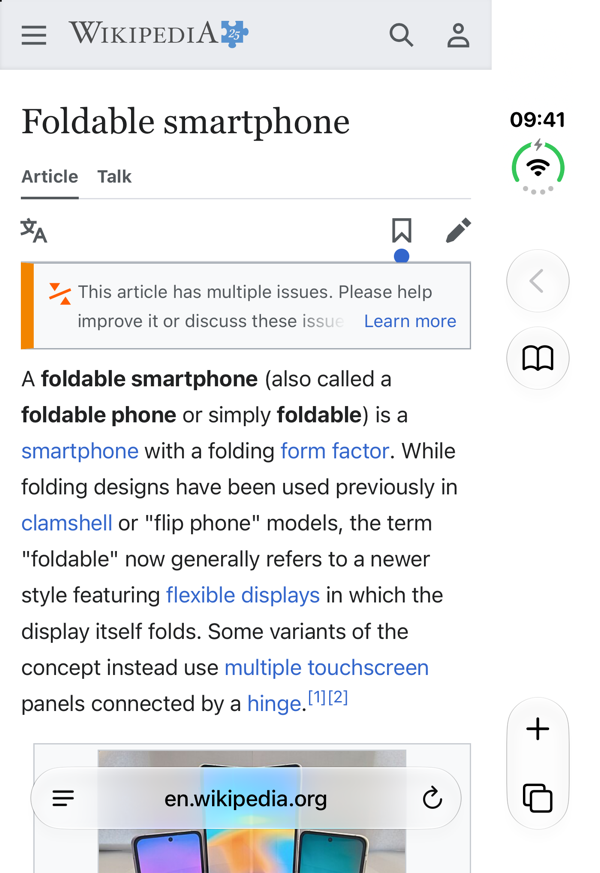
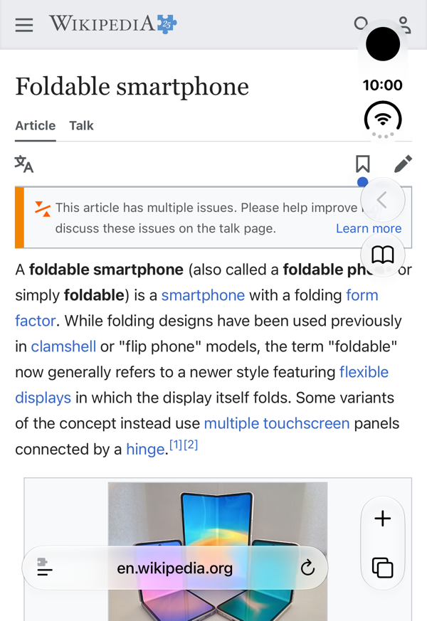

# Edge to Edge

A free Safari extension for the folded iPhone Duo. On the outer display Safari keeps an empty strip down the side of every page. Edge to Edge makes pages use the whole display, fixed headers, cookie banners and bottom bars included.

| Before | After |
| --- | --- |
|  |  |

## Install

- **TestFlight:** _link coming soon_
- **Build it yourself:** open `Edge to Edge/Edge to Edge.xcodeproj` in Xcode, pick your team under Signing & Capabilities and run it on your iPhone.

Then turn it on in **Settings › Apps › Safari › Extensions › Edge to Edge**: switch on **Allow Extension** and set **All Websites** to **Allow**.

## How it works

On the outer display Safari tells pages they are 382 points wide, but its web view actually covers the full 466 points and draws its own buttons over the right-hand side. The extension rewrites the page's `<meta name="viewport">` from `width=device-width` to the real size of the display, so the page lays out at full width and fixed and sticky elements reach the edge too. Safari's buttons stay where they are, floating over the page.

- Only pages laid out for phone screens (`width=device-width`) are touched. Desktop and fixed-width pages are left alone.
- Nothing changes when there is no strip, such as on the inner display or on other iPhones.
- The Edge to Edge button in Safari turns it off globally or for the current site.

All the work happens in [`content.js`](<Edge to Edge/Edge to Edge Extension/Resources/content.js>), about a hundred lines.

## Privacy

Edge to Edge collects no data, makes no network requests and has no analytics. Safari asks for permission to "read and alter webpages" because the extension has to change each page's viewport tag; that is all it does. See [PRIVACY.md](PRIVACY.md).

## License

MIT, see [LICENSE](LICENSE).
